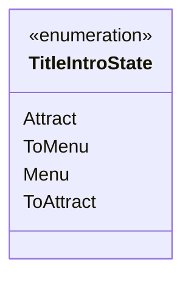

# TitleIntroState

**Módulo:** [[Modulo Menu|Menu]] · **Namespace:** `AlienFarms.Menu` · **Archivo:** `Assets/Scripts/Menu/TitleIntroState.cs`

## Diagrama

## Valores
`Attract`, `ToMenu`, `Menu`, `ToAttract`

## Usado por
[[TitleIntroDirector]], [[TitleIntroModel]]
