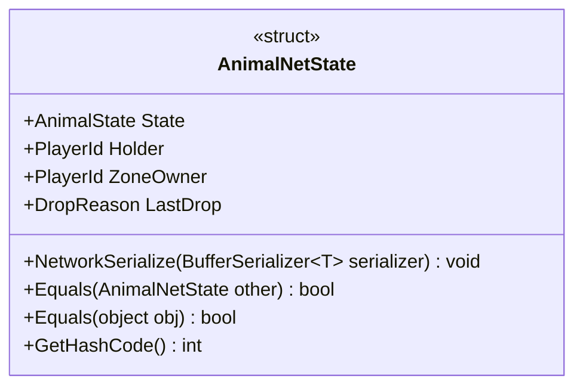

# AnimalNetState

> Replicated gameplay state of an animal: its `AnimalState`, who carries it, whose pen holds it and why it last left a player's hands (clients raise the same drop GameEvent the server did). 4 bytes.

**Módulo:** [[Modulo Networking|Networking]] · **Namespace:** `AlienFarms.Networking.Animals` · **Archivo:** `Assets/Scripts/Networking/Animals/AnimalNetState.cs`

## Hereda / implementa
`INetworkSerializable`, `IEquatable`

## Diagrama

## Usa
[[AnimalState]], [[DropReason]], [[PlayerId]]

## Usado por
[[NetworkAnimal]]
