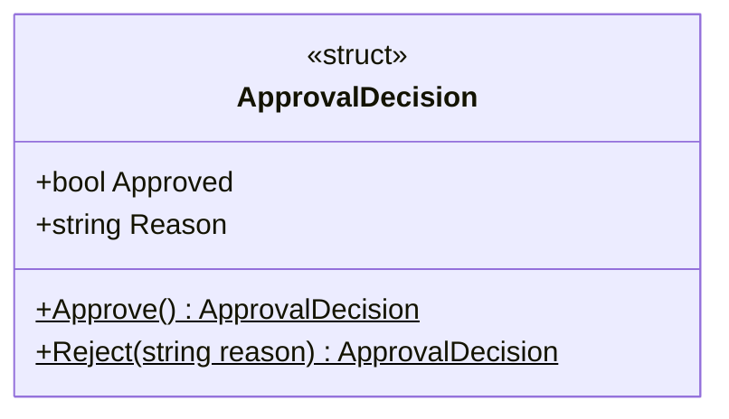

# ApprovalDecision

> Outcome of `ApprovalRules.Evaluate`: approved, or rejected with a reason key sent to the client.

**Módulo:** [[Modulo Networking|Networking]] · **Namespace:** `AlienFarms.Networking.Session` · **Archivo:** `Assets/Scripts/Networking/Session/ApprovalDecision.cs`

## Diagrama

## Usado por
[[ApprovalRules]], [[ConnectionApprovalHandler]]
