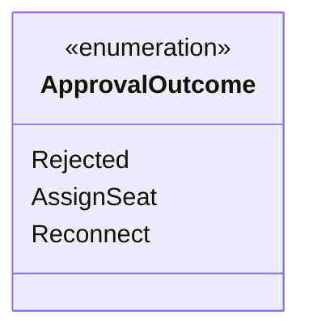

# ApprovalOutcome

> What an `ApprovalDecision` lets the connecting client do.

**Módulo:** [[Modulo Networking|Networking]] · **Namespace:** `AlienFarms.Networking.Session` · **Archivo:** `Assets/Scripts/Networking/Session/ApprovalOutcome.cs`

## Diagrama

## Valores
`Rejected`, `AssignSeat`, `Reconnect`

## Usado por
[[ApprovalDecision]], [[ConnectionApprovalHandler]], [[ServerSlotDirectory]]
