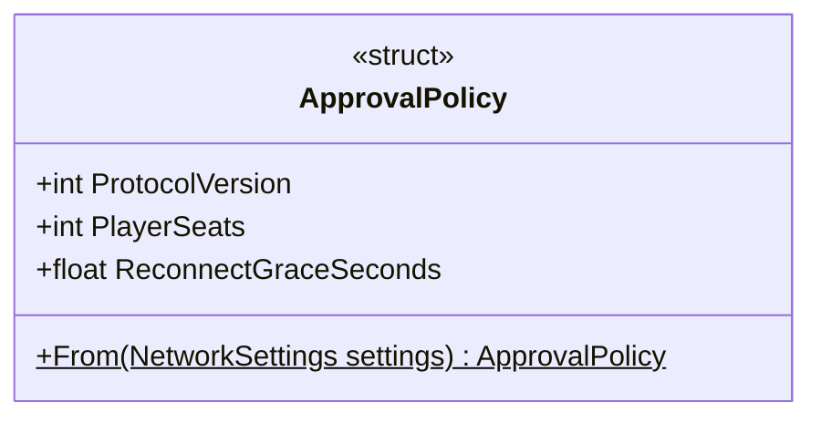

# ApprovalPolicy

> Session limits the `ApprovalRules` apply. Immutable; built from `NetworkSettings`.

**Módulo:** [[Modulo Networking|Networking]] · **Namespace:** `AlienFarms.Networking.Session` · **Archivo:** `Assets/Scripts/Networking/Session/ApprovalPolicy.cs`

## Diagrama

## Usa
[[NetworkSettings]], [[ServerSlotDirectory]]

## Usado por
[[ApprovalRules]], [[ConnectionApprovalHandler]]
