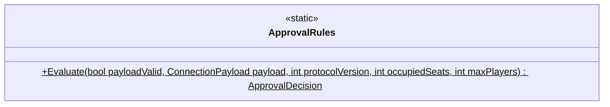

# ApprovalRules

> Pure connection approval rules (version 1.5): valid payload, same protocol and a free seat. Reconnection to a previous seat and spectators come in week 2. Reasons are stable keys the client maps to localized text.

**Módulo:** [[Modulo Networking|Networking]] · **Namespace:** `AlienFarms.Networking.Session` · **Archivo:** `Assets/Scripts/Networking/Session/ApprovalRules.cs`

## Diagrama

## Usa
[[ApprovalDecision]], [[ConnectionPayload]], [[DisconnectReasons]]

## Usado por
[[ConnectionApprovalHandler]]
