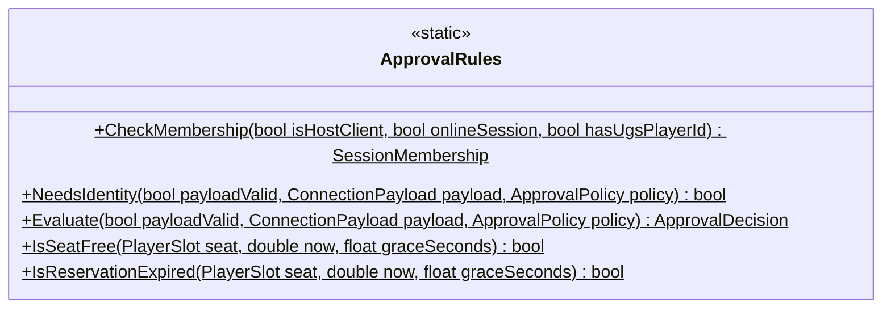

# ApprovalRules

> Pure connection approval rules, in order: same protocol, valid payload, one connection per UGS player (a dropped player gets its own seat back while the grace lasts), a free seat (Player1 first), otherwise "room full". Every rejection carries a `DisconnectReasons` key the client maps to localized text.

**Módulo:** [[Modulo Networking|Networking]] · **Namespace:** `AlienFarms.Networking.Session` · **Archivo:** `Assets/Scripts/Networking/Session/ApprovalRules.cs`

## Diagrama

## Usa
[[ApprovalDecision]], [[ApprovalPolicy]], [[ConnectionPayload]], [[DisconnectReasons]], [[PlayerId]], [[PlayerSlot]], [[SessionMembership]]

## Usado por
[[ConnectionApprovalHandler]], [[SeatGraceRules]], [[ServerSlotDirectory]]
