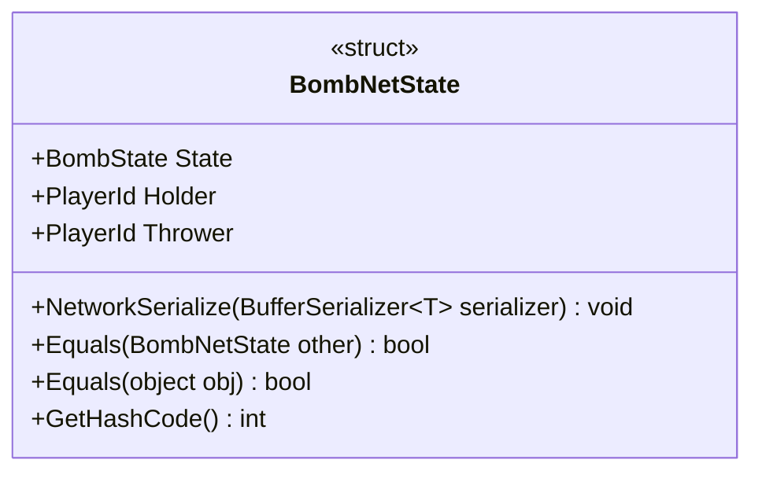

# BombNetState

> Replicated gameplay state of a bomb: its `BombState`, who carries it and who threw it. 3 bytes.

**Módulo:** [[Modulo Networking|Networking]] · **Namespace:** `AlienFarms.Networking.Items` · **Archivo:** `Assets/Scripts/Networking/Items/BombNetState.cs`

## Hereda / implementa
`INetworkSerializable`, `IEquatable`

## Diagrama

## Usa
[[BombState]], [[PlayerId]]

## Usado por
[[NetworkBomb]]
