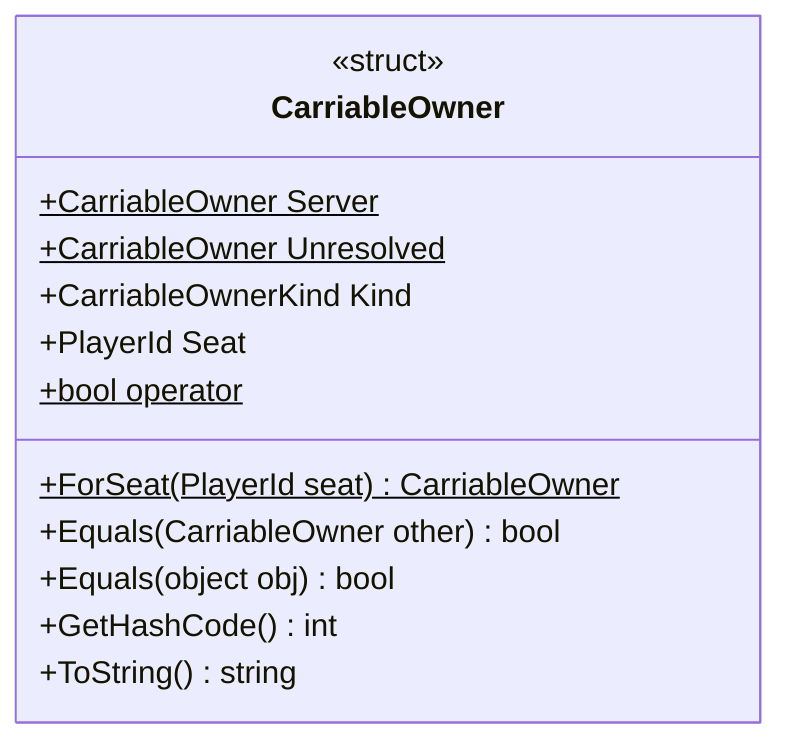

# CarriableOwner

> Resolved owner of a carriable object: the server, a seat, or a client not resolved yet.

**Módulo:** [[Modulo Networking|Networking]] · **Namespace:** `AlienFarms.Networking.Player` · **Archivo:** `Assets/Scripts/Networking/Player/CarriableOwner.cs`

## Hereda / implementa
`IEquatable`

## Diagrama

## Usa
[[CarriableOwnerKind]], [[PlayerId]]

## Usado por
[[CarriableOwnerRules]], [[CarriableOwnerTint]], [[CarriableOwnershipLabel]], [[NetworkCarriable]], [[OwnershipLabelCache]]
