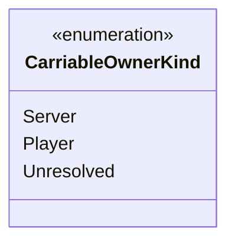

# CarriableOwnerKind

> Who a carriable object belongs to, as shown by its ownership tint and debug label.

**Módulo:** [[Modulo Networking|Networking]] · **Namespace:** `AlienFarms.Networking.Player` · **Archivo:** `Assets/Scripts/Networking/Player/CarriableOwnerKind.cs`

## Hereda / implementa
`byte`

## Diagrama

## Valores
`Server`, `Player`, `Unresolved`

## Usado por
[[CarriableOwner]], [[CarriableOwnerRules]], [[CarriableOwnerTint]], [[CarriableOwnershipLabel]]
