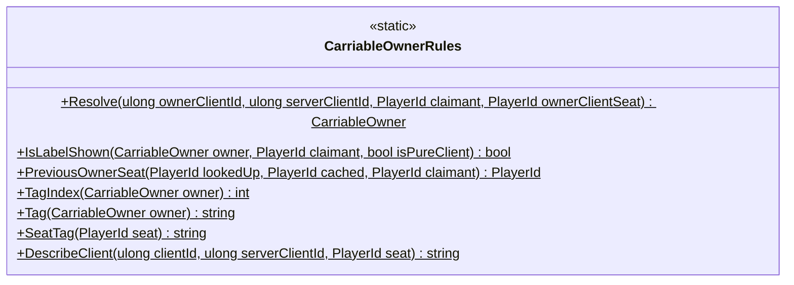

# CarriableOwnerRules

> Pure mapping from NGO ownership to what the tint / debug label / log show. On a host the server's client id is also P1's: what the host carries stays server-owned, so "owned by the server" means P1 only while P1 claims it.

**Módulo:** [[Modulo Networking|Networking]] · **Namespace:** `AlienFarms.Networking.Player` · **Archivo:** `Assets/Scripts/Networking/Player/CarriableOwnerRules.cs`

## Diagrama

## Usa
[[CarriableOwner]], [[CarriableOwnerKind]], [[PlayerId]]

## Usado por
[[CarriableOwnershipLabel]], [[NameTagRules]], [[NetworkCarriable]], [[OwnershipLabelCache]]
