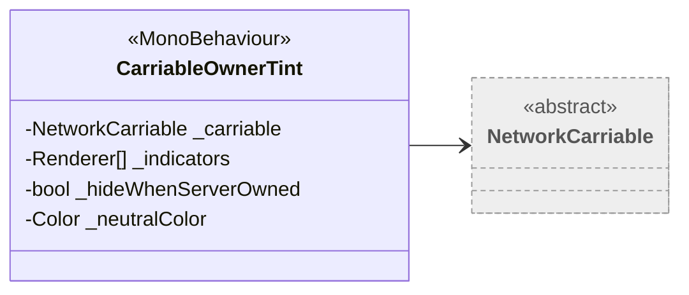

# CarriableOwnerTint

> Course topic 2: the object takes the color of whoever owns it. Colors indicator renderers (a ring / halo child, never the object's own art) with the owner character's `CharacterTheme.Primary` through a `MaterialPropertyBlock` (no material instances). Server-owned (free, penned, dropped): hidden or neutral. Runs on every instance and only reacts to `NetworkCarriable.ViewChanged`; when the owner's avatar or character is not known yet (late join) it retries once per frame until it resolves (no allocation).

**Módulo:** [[Modulo Networking|Networking]] · **Namespace:** `AlienFarms.Networking.Player` · **Archivo:** `Assets/Scripts/Networking/Player/CarriableOwnerTint.cs`

## Hereda / implementa
`MonoBehaviour`

## Diagrama

## Usa
[[CarriableOwner]], [[CarriableOwnerKind]], [[CharacterDefinition]], [[NetworkCarriable]], [[NetworkPlayer]]
