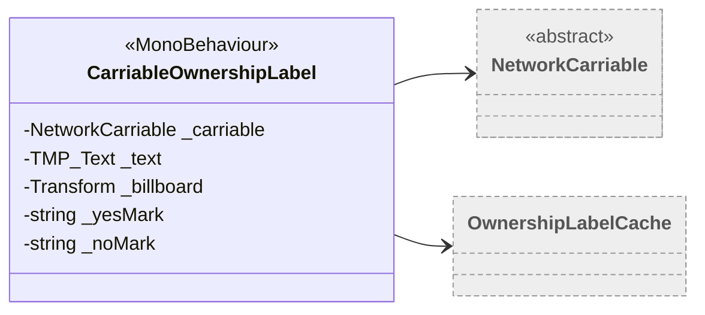

# CarriableOwnershipLabel

> Course topic 2: world-space debug label over a carriable object, "Owner: P2 · IsOwner ✓ · HasAuthority ✗" (owner as resolved by `NetworkCarriable.ResolveOwner`; IsOwner / HasAuthority of THIS machine). Shown while somebody claims the object or the server does not own it, and only while `OwnershipLabelToggle` (default: `AlienFarms.Data.NetworkSettings.ShowOwnershipLabels`) allows it. The text is rebuilt only on `NetworkCarriable.ViewChanged` (cached strings, no allocation); while shown it faces the anchor's local avatar camera in LateUpdate. In NGO client-server HasAuthority is true only on the server, whoever owns it.

**Módulo:** [[Modulo Networking|Networking]] · **Namespace:** `AlienFarms.Networking.Player` · **Archivo:** `Assets/Scripts/Networking/Player/CarriableOwnershipLabel.cs`

## Hereda / implementa
`MonoBehaviour`

## Diagrama

## Usa
[[CarriableOwner]], [[CarriableOwnerKind]], [[CarriableOwnerRules]], [[NetworkCarriable]], [[OwnershipLabelCache]], [[OwnershipLabelToggle]]
