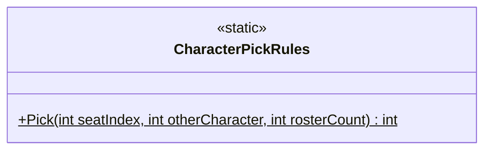

# CharacterPickRules

> Pure rule of the default character of a seat that reached the gameplay scene without a pick (e.g. a new client taking a seat freed mid-match): the seat's own index, or the next free one when the other seat already uses it.

**Módulo:** [[Modulo Networking|Networking]] · **Namespace:** `AlienFarms.Networking.Player` · **Archivo:** `Assets/Scripts/Networking/Player/CharacterPickRules.cs`

## Diagrama

## Usado por
[[NetworkPlayerRoster]]
