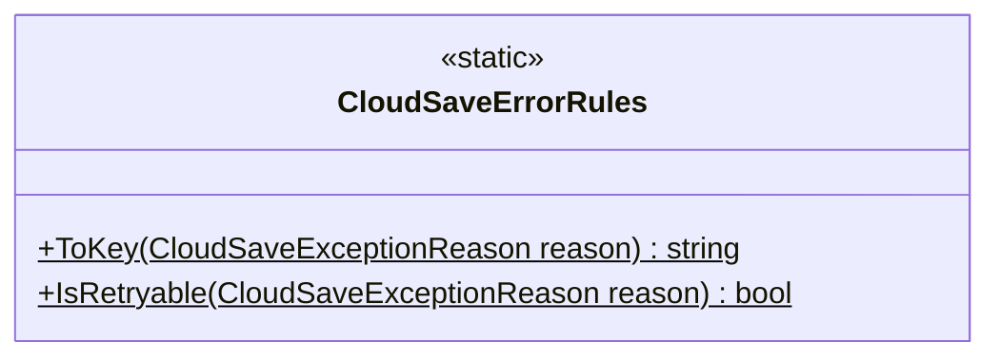

# CloudSaveErrorRules

> Cloud Save failure reason → localization key (`PlayerProgressErrorKeys`) and whether to retry.

**Módulo:** [[Modulo Networking|Networking]] · **Namespace:** `AlienFarms.Networking.Persistence` · **Archivo:** `Assets/Scripts/Networking/Persistence/CloudSaveErrorRules.cs`

## Diagrama

## Usa
[[PlayerProgressErrorKeys]]

## Usado por
[[CloudSavePlayerStatsStore]]
