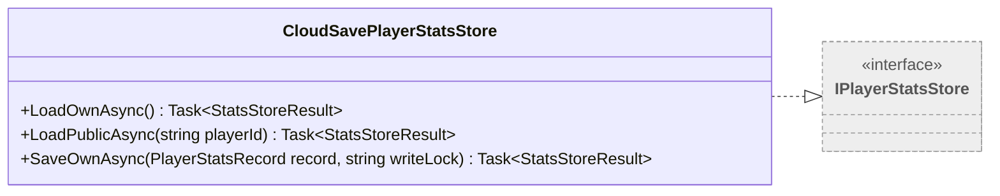

# CloudSavePlayerStatsStore

> The only class that talks to Cloud Save (3.4.x): the stats record lives in Player Data under `PlayerStatsCodec.Key` with the Public access class (only its owner writes it; anyone reads it by player id). Exceptions become `StatsStoreResult`s: conflict → `StatsStoreOutcome.Conflict`, rate limit → retryable with Retry-After, other Cloud Save failures through `CloudSaveErrorRules`, anything else → `PlayerProgressErrorKeys.Unknown`. Requires Unity Services initialized and signed in. The SDK calls take no cancellation token. Allocates per call (one per round or load), never per frame.

**Módulo:** [[Modulo Networking|Networking]] · **Namespace:** `AlienFarms.Networking.Persistence` · **Archivo:** `Assets/Scripts/Networking/Persistence/CloudSavePlayerStatsStore.cs`

## Hereda / implementa
[[IPlayerStatsStore]]

## Diagrama

## Usa
[[CloudSaveErrorRules]], [[IPlayerStatsStore]], [[PlayerProgressErrorKeys]], [[PlayerStatsCodec]], [[PlayerStatsRecord]], [[StatsReadResult]], [[StatsStoreResult]]

## Usado por
[[CloudSaveStatsService]]
