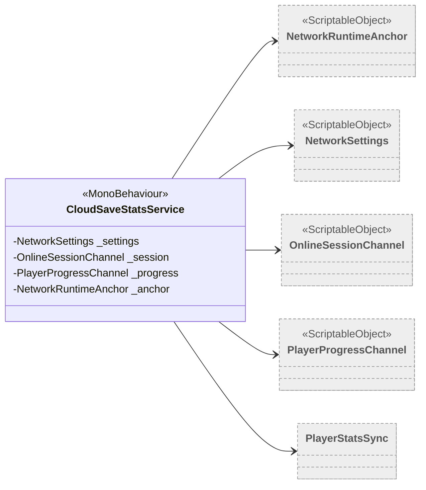

# CloudSaveStatsService

> Cloud stats service on the persistent NetworkRoot (task 2.8). Composition root of `PlayerStatsSync`: the anchor's `NetworkRuntimeAnchor.PlayerStats` ledger, Cloud Save (behind the simulated-failure decorator), the online session channel (UGS id, participants) and the progress channel it is the only writer of. Loads when the UGS id changes, saves whenever a round is pending, retries with backoff (cancelled in `OnDisable`) and reads the rival in the room. Event driven: no Update.

**Módulo:** [[Modulo Networking|Networking]] · **Namespace:** `AlienFarms.Networking.Persistence` · **Archivo:** `Assets/Scripts/Networking/Persistence/CloudSaveStatsService.cs`

## Hereda / implementa
`MonoBehaviour`

## Diagrama

## Usa
[[CloudSavePlayerStatsStore]], [[IPlayerStatsStore]], [[NetworkRuntimeAnchor]], [[NetworkSettings]], [[OnlineSessionChannel]], [[PlayerProgressChannel]], [[PlayerStatsSync]], [[SimulatedFailureStatsStore]]
