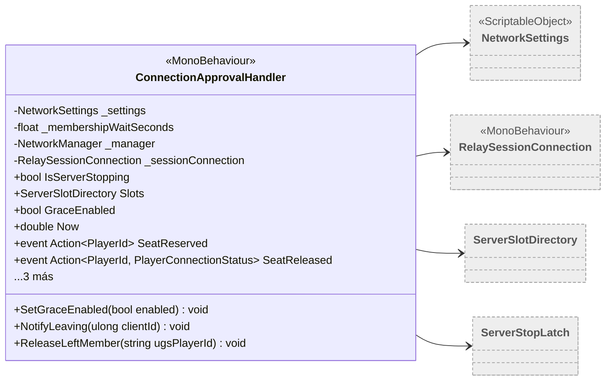

# ConnectionApprovalHandler

> Server connection approval: parses the `ConnectionPayload` (name sanitized), verifies in an online session that the declared UGS player id is a member of it (`ApprovalRules.CheckMembership`), applies `ApprovalRules` (protocol, one connection per UGS player, reconnection, Player1 then Player2, then room full) and records the result in the `ServerSlotDirectory`. A rejection carries its `DisconnectReasons` key in the response. No player object is created by NGO: the gameplay scene's roster spawns it. Also runs for the host's own client (never verified nor deferred: NGO approves it synchronously). Membership race: a client joins the lobby (server side) before it can read the Relay code and connect, but the host's copy of the player list is updated asynchronously (lobby events or polling), so the NGO request may arrive first. An id not listed yet leaves the approval pending (ConnectionApprovalResponse.Pending): the session is refreshed from the service once and the list re-checked until the id is listed or the membership wait passes (then rejected as `DisconnectReasons.NotSessionMember`). The seat is decided only once confirmed, against the table as it is then.

**Módulo:** [[Modulo Networking|Networking]] · **Namespace:** `AlienFarms.Networking.Session` · **Archivo:** `Assets/Scripts/Networking/Session/ConnectionApprovalHandler.cs`

## Hereda / implementa
`MonoBehaviour`

## Diagrama

## Usa
[[ApprovalDecision]], [[ApprovalOutcome]], [[ApprovalPolicy]], [[ApprovalRules]], [[ConnectionPayload]], [[DisconnectReasons]], [[NetworkSettings]], [[PlayerConnectionStatus]], [[PlayerId]], [[PlayerSlot]], [[RelaySessionConnection]], [[SeatDropOutcome]], [[SeatGraceRules]], [[ServerSlotDirectory]], [[ServerStopLatch]], [[SessionMembership]]

## Usado por
[[LeaveNoticeMessenger]], [[NetworkRootLifetime]], [[NetworkRuntimeAnchor]], [[OnlineSessionService]], [[ReconnectGraceCoordinator]], [[SessionExit]]
