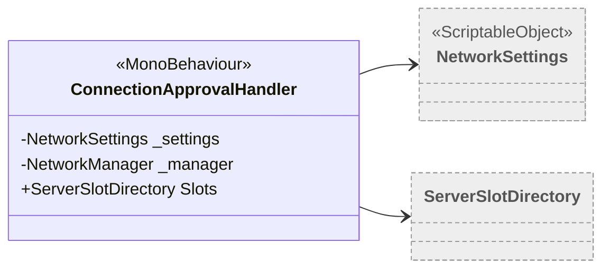

# ConnectionApprovalHandler

> Server connection approval (version 1.5): parses the `ConnectionPayload`, applies `ApprovalRules` and seats the client in the `ServerSlotDirectory` (Player1, then Player2). No player object is created by NGO: the gameplay scene's roster spawns it. Also runs for the host's own client.

**Módulo:** [[Modulo Networking|Networking]] · **Namespace:** `AlienFarms.Networking.Session` · **Archivo:** `Assets/Scripts/Networking/Session/ConnectionApprovalHandler.cs`

## Hereda / implementa
`MonoBehaviour`

## Diagrama

## Usa
[[ApprovalDecision]], [[ApprovalRules]], [[ConnectionPayload]], [[NetworkSettings]], [[PlayerId]], [[PlayerSlot]], [[ServerSlotDirectory]]

## Usado por
[[NetworkRootLifetime]], [[NetworkRuntimeAnchor]]
