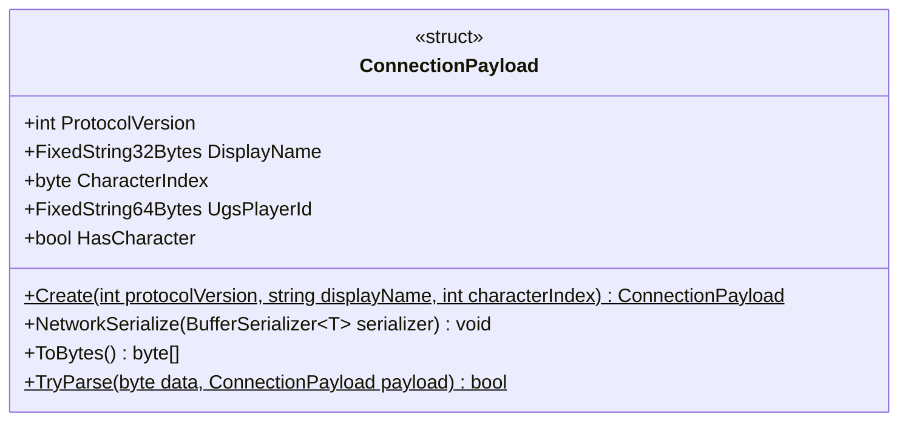

# ConnectionPayload

> What a client sends in `NetworkConfig.ConnectionData` when it connects. Written by the client, read by the server's approval. `UgsPlayerId` is reserved for reconnection (week 2) and not evaluated yet.

**Módulo:** [[Modulo Networking|Networking]] · **Namespace:** `AlienFarms.Networking.Session` · **Archivo:** `Assets/Scripts/Networking/Session/ConnectionPayload.cs`

## Hereda / implementa
`INetworkSerializable`

## Diagrama

## Usado por
[[ApprovalRules]], [[ConnectionApprovalHandler]], [[DevConnectionPanel]], [[NetworkPlayer]], [[NetworkPlayerRoster]], [[ServerSlotDirectory]], [[Status]]
