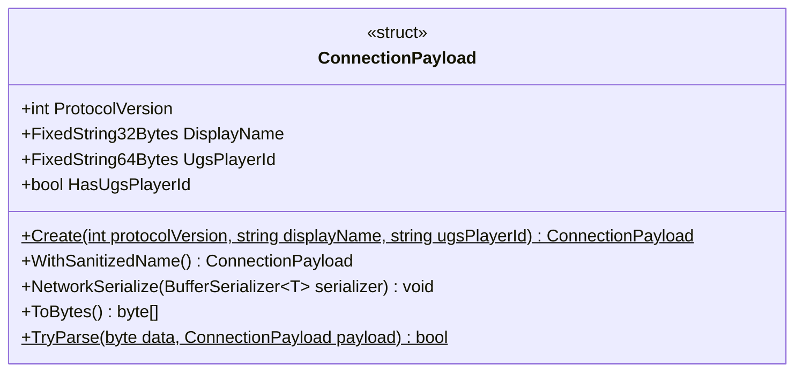

# ConnectionPayload

> What a client sends in `NetworkConfig.ConnectionData` when it connects. Written by the client, read by the server's approval (`ApprovalRules`): `UgsPlayerId` identifies the player across reconnections (empty for a direct dev connection without Unity Gaming Services). The character is picked inside the online room (`NetworkLobbyState`), so it is not part of the payload (removed in protocol 2).

**Módulo:** [[Modulo Networking|Networking]] · **Namespace:** `AlienFarms.Networking.Session` · **Archivo:** `Assets/Scripts/Networking/Session/ConnectionPayload.cs`

## Hereda / implementa
`INetworkSerializable`

## Diagrama

## Usa
[[DisplayNameSanitizer]]

## Usado por
[[ApprovalRules]], [[ConnectionApprovalHandler]], [[DevConnectionPanel]], [[OnlineSessionService]], [[ServerSlotDirectory]], [[SessionExit]], [[Status]]
