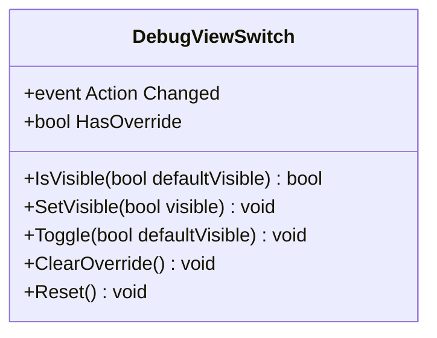

# DebugViewSwitch

> Machine-local visibility switch of one debug view: without an override the view follows its default (a NetworkSettings flag); the debug overlay (F1–F4, task 3.3) sets or flips the override and listeners re-read `IsVisible` on `Changed`. Pure C#; the static facades (`OwnershipLabelToggle`, `PoolStatsToggle`) own one each and reset it on play-mode entry.

**Módulo:** [[Modulo Networking|Networking]] · **Namespace:** `AlienFarms.Networking.Diagnostics` · **Archivo:** `Assets/Scripts/Networking/Diagnostics/DebugViewSwitch.cs`

## Diagrama

## Usado por
[[OwnershipLabelToggle]], [[PoolStatsToggle]]
