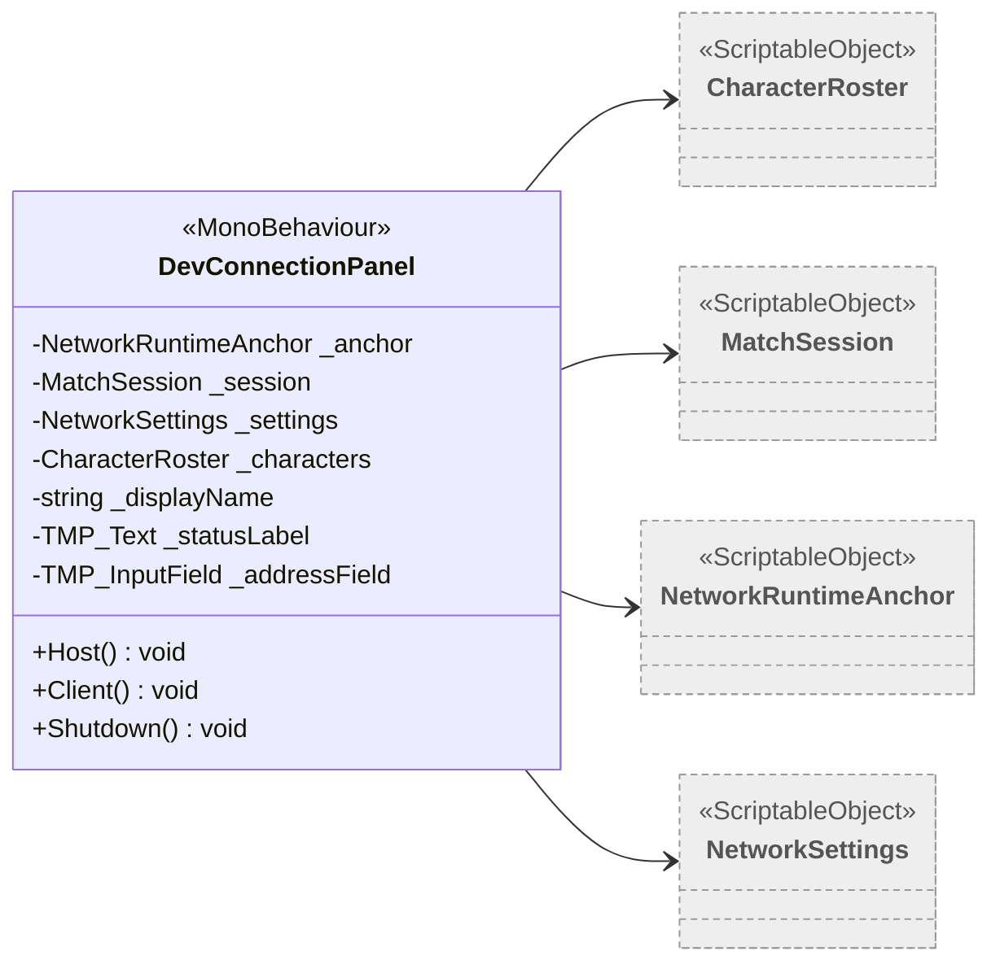

# DevConnectionPanel

> Development connection panel (logic only; the Canvas lives in the scene). Host / Client / Shutdown are wired to buttons' OnClick. Host and Client switch the session to online and start the root's connection strategy (direct IP); the host then loads the gameplay scene for everyone. The status label is rebuilt only when the state changes.

**Módulo:** [[Modulo Networking|Networking]] · **Namespace:** `AlienFarms.Networking.Diagnostics` · **Archivo:** `Assets/Scripts/Networking/Diagnostics/DevConnectionPanel.cs`

## Hereda / implementa
`MonoBehaviour`

## Diagrama

## Usa
[[CharacterRoster]], [[ConnectionPayload]], [[DirectConnection]], [[GameMode]], [[IConnectionStrategy]], [[MatchSession]], [[NetworkRootLifetime]], [[NetworkRuntimeAnchor]], [[NetworkSceneLoader]], [[NetworkSettings]], [[SceneFlow]], [[SceneNames]], [[Status]]
