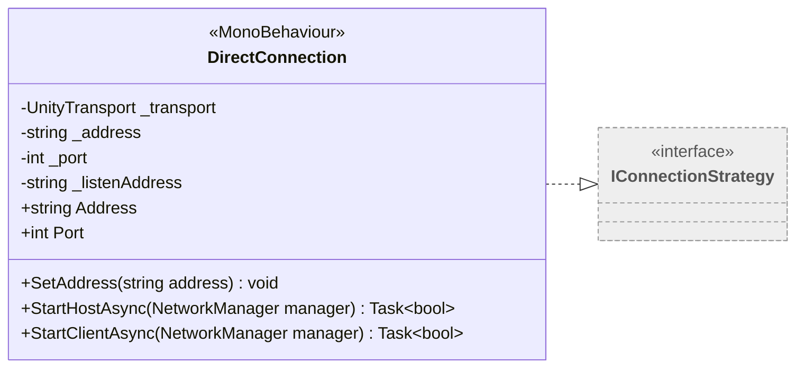

# DirectConnection

> Direct IP connection (Multiplayer Play Mode, LAN or the relay fallback): sets the UnityTransport address and port, then starts NGO synchronously.

**Módulo:** [[Modulo Networking|Networking]] · **Namespace:** `AlienFarms.Networking.Session` · **Archivo:** `Assets/Scripts/Networking/Session/DirectConnection.cs`

## Hereda / implementa
`MonoBehaviour`, [[IConnectionStrategy]]

## Diagrama

## Usa
[[IConnectionStrategy]]

## Usado por
[[DevConnectionPanel]], [[Status]]
