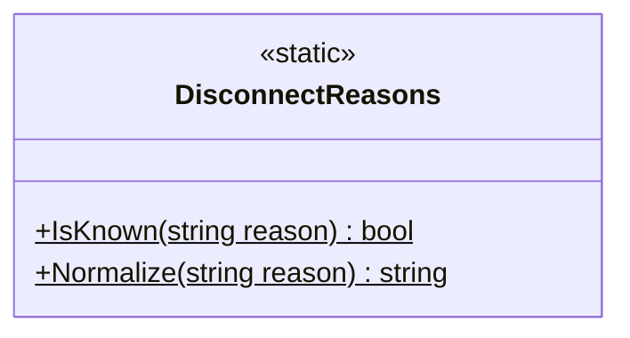

# DisconnectReasons

> The only disconnect / rejection reasons the game sends, as stable keys the UI maps to text. NGO fills DisconnectReason with raw transport text when the server gave none, so clients show only these keys (`Normalize`).

**Módulo:** [[Modulo Networking|Networking]] · **Namespace:** `AlienFarms.Networking.Session` · **Archivo:** `Assets/Scripts/Networking/Session/DisconnectReasons.cs`

## Diagrama

## Usado por
[[ApprovalRules]], [[NetworkRootLifetime]], [[OnlineMatchBootstrap]]
