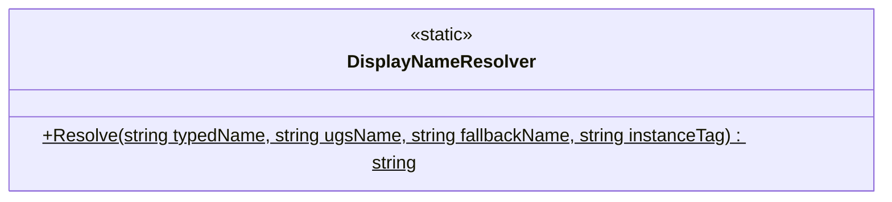

# DisplayNameResolver

> Name sent in the connection payload and the session: the one typed on this device, else the generated UGS name, else the serialized fallback tagged with this process's instance (MPPM clones share PlayerPrefs and, without UGS, would all be "Player"). Pure; every candidate is sanitized and fitted to the payload's bytes keeping a UGS discriminator ("Name#1234"; see `DisplayNameSanitizer.FitToPayload`), so every machine shows the same.

**Módulo:** [[Modulo Networking|Networking]] · **Namespace:** `AlienFarms.Networking.Session` · **Archivo:** `Assets/Scripts/Networking/Session/DisplayNameResolver.cs`

## Diagrama

## Usa
[[DisplayNameSanitizer]]

## Usado por
[[DevConnectionPanel]], [[OnlineSessionService]], [[SessionExit]], [[Status]]
