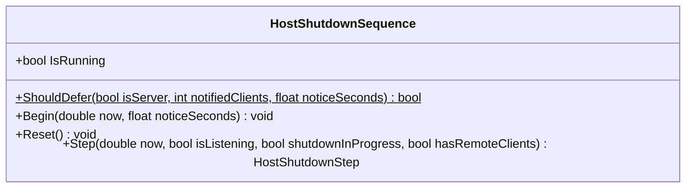

# HostShutdownSequence

> Graceful shutdown of a host that still has remote clients (pure logic, driven every frame by `NetworkRootLifetime`). The host already sent the leaving notice when it begins: Announcing: the connections stay open for the notice time, so the reliable notice is delivered (and resent). Disconnecting: every remote client is disconnected with a reason; NGO sends it and closes them on its next late update, so the transport is not disposed in the same frame (a short flush wait at most). Stopping: NetworkManager.Shutdown(), then wait until it stops listening (bounded by a timeout). NGO stopping by itself at any point (shutdown elsewhere, transport failure) skips to Stopping. Times are real time.

**Módulo:** [[Modulo Networking|Networking]] · **Namespace:** `AlienFarms.Networking.Session` · **Archivo:** `Assets/Scripts/Networking/Session/HostShutdownSequence.cs`

## Diagrama

## Usa
[[HostShutdownStep]], [[Phase]]

## Usado por
[[NetworkRootLifetime]]
