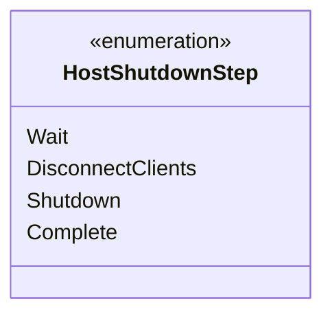

# HostShutdownStep

> What `HostShutdownSequence.Step` asks the root to do on this frame.

**Módulo:** [[Modulo Networking|Networking]] · **Namespace:** `AlienFarms.Networking.Session` · **Archivo:** `Assets/Scripts/Networking/Session/HostShutdownStep.cs`

## Diagrama

## Valores
`Wait`, `DisconnectClients`, `Shutdown`, `Complete`

## Usado por
[[HostShutdownSequence]], [[NetworkRootLifetime]], [[Phase]]
