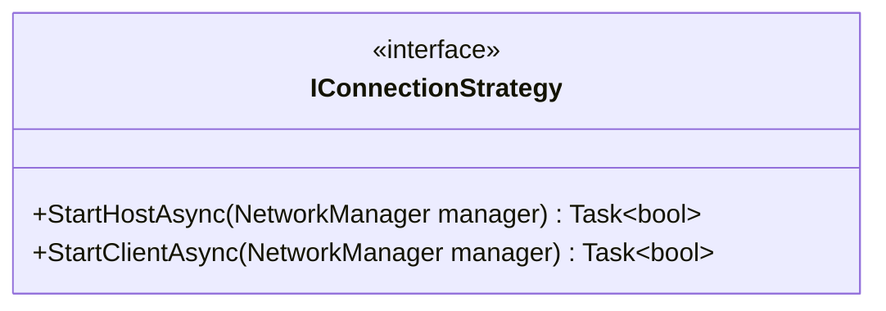

# IConnectionStrategy

> How a session is started: direct IP (`DirectConnection`) or, later, Sessions + Relay. Asynchronous so a relay allocation fits the same contract. The caller writes `NetworkConfig.ConnectionData` first.

**Módulo:** [[Modulo Networking|Networking]] · **Namespace:** `AlienFarms.Networking.Session` · **Archivo:** `Assets/Scripts/Networking/Session/IConnectionStrategy.cs`

## Derivados / implementaciones
[[DirectConnection]], [[RelaySessionConnection]]

## Diagrama

## Usado por
[[DevConnectionPanel]], [[DirectConnection]], [[NetworkRootLifetime]], [[NetworkRuntimeAnchor]], [[RelaySessionConnection]], [[Status]]
