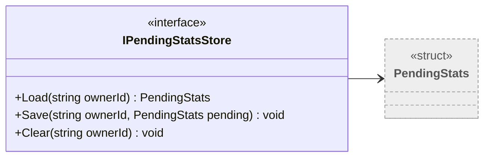

# IPendingStatsStore

> Local storage of the unconfirmed stats, one entry per account (survives closing the game). Implementations ignore (and delete) invalid or newer entries.

**Módulo:** [[Modulo Networking|Networking]] · **Namespace:** `AlienFarms.Networking.Persistence` · **Archivo:** `Assets/Scripts/Networking/Persistence/IPendingStatsStore.cs`

## Derivados / implementaciones
[[PlayerPrefsPendingStatsStore]]

## Diagrama

## Usa
[[PendingStats]]

## Usado por
[[PlayerPrefsPendingStatsStore]], [[PlayerStatsLedger]]
