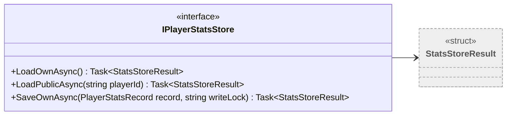

# IPlayerStatsStore

> Strategy for the persisted stats of the signed-in player (key `PlayerStatsCodec.Key`). Implementations never throw: every failure comes back as a `StatsStoreResult`.

**Módulo:** [[Modulo Networking|Networking]] · **Namespace:** `AlienFarms.Networking.Persistence` · **Archivo:** `Assets/Scripts/Networking/Persistence/IPlayerStatsStore.cs`

## Derivados / implementaciones
[[CloudSavePlayerStatsStore]], [[SimulatedFailureStatsStore]]

## Diagrama

## Usa
[[PlayerStatsRecord]], [[StatsStoreResult]]

## Usado por
[[CloudSavePlayerStatsStore]], [[CloudSaveStatsService]], [[PlayerStatsSync]], [[SimulatedFailureStatsStore]]
