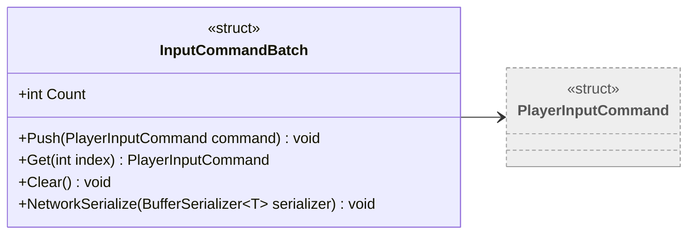

# InputCommandBatch

> The last `MaxCommands` commands of a player, newest first, sent in every unreliable input packet so a lost packet is recovered by the next ones. Fixed fields, no arrays: no allocations to build or read it.

**Módulo:** [[Modulo Networking|Networking]] · **Namespace:** `AlienFarms.Networking.Player` · **Archivo:** `Assets/Scripts/Networking/Player/InputCommandBatch.cs`

## Hereda / implementa
`INetworkSerializable`

## Diagrama

## Usa
[[PlayerInputCommand]]

## Usado por
[[Mode]], [[NetworkPlayerInput]]
