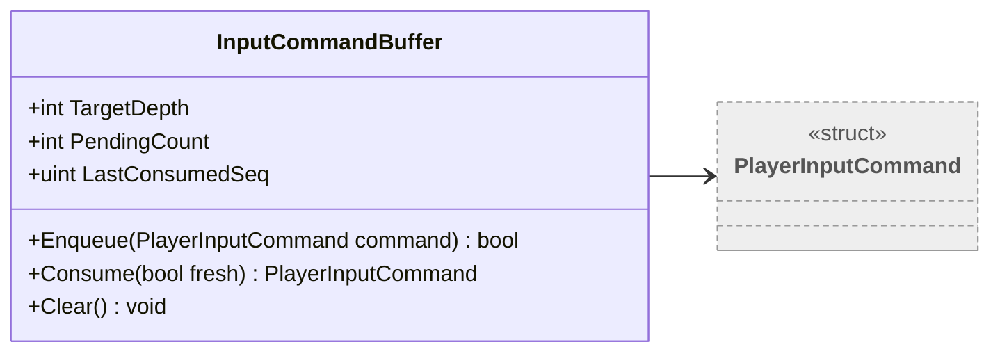

# InputCommandBuffer

> Server-side jitter buffer of one player's commands, consumed one per physics step. Waits until `TargetDepth` commands are queued before playing. Drops duplicates and commands at or before the last consumed one (signed sequence distance, so the 32-bit sequence may wrap around; 0 is never a command). Skips sequence gaps that later packets prove lost. Trims the queue past `TargetDepth` + `MaxExtraDepth`; a Grab held in a trimmed command is carried into the next one so a press is never lost. Repeats the last command when it runs dry. Resynchronizes to a command a little beyond the window, but ignores absurd jumps (> `MaxResyncDistance`). Fixed ring, no allocations.

**Módulo:** [[Modulo Networking|Networking]] · **Namespace:** `AlienFarms.Networking.Player` · **Archivo:** `Assets/Scripts/Networking/Player/InputCommandBuffer.cs`

## Diagrama

## Usa
[[PlayerInputCommand]]

## Usado por
[[Mode]], [[NetworkPlayerInput]]
