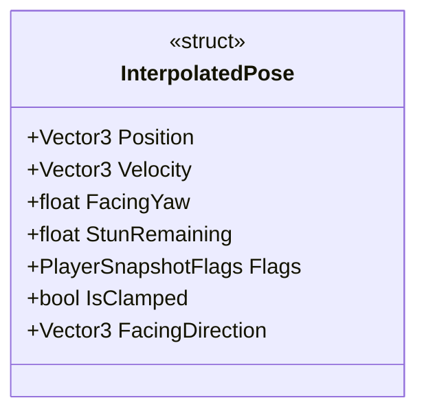

# InterpolatedPose

> Pose sampled by `SnapshotInterpolator` at a render time.

**Módulo:** [[Modulo Networking|Networking]] · **Namespace:** `AlienFarms.Networking.Prediction` · **Archivo:** `Assets/Scripts/Networking/Prediction/InterpolatedPose.cs`

## Diagrama

## Usa
[[PlayerSnapshotFlags]]

## Usado por
[[NetworkPlayerMotion]], [[SnapshotInterpolator]]
