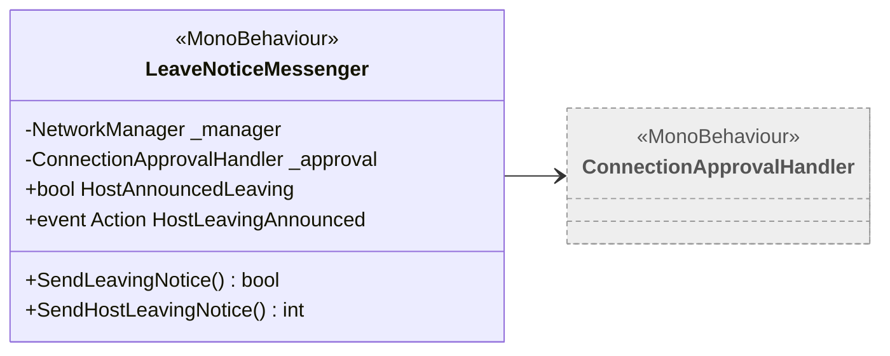

# LeaveNoticeMessenger

> Voluntary-leave notice over an NGO named message: a pure client calls `SendLeavingNotice` right before it shuts down, so the server frees its seat at once (`ConnectionApprovalHandler.NotifyLeaving`) instead of holding it for the reconnection grace. Best-effort: NGO flushes its send queue before closing; if the notice is lost, the session's PlayerHasLeft (`ConnectionApprovalHandler.ReleaseLeftMember`) or the grace frees the seat. The handler is registered only on the server (clients just send), when it starts, and removed when it stops. The other way round, a host leaving on purpose sends `SendHostLeavingNotice` to every client while their connections are still open (reliable, so it is resent until delivered), and only disconnects them after a short wait (`NetworkRootLifetime.ShutdownSessionAsync`). A pure client registers that handler when it starts and keeps `HostAnnouncedLeaving` until its next start, so its drop resolves to `DisconnectReasons.HostDisconnected` even when NGO's reason message is lost with the connection (`DisconnectReasons.Resolve`).

**Módulo:** [[Modulo Networking|Networking]] · **Namespace:** `AlienFarms.Networking.Session` · **Archivo:** `Assets/Scripts/Networking/Session/LeaveNoticeMessenger.cs`

## Hereda / implementa
`MonoBehaviour`

## Diagrama

## Usa
[[ConnectionApprovalHandler]]

## Usado por
[[NetworkRootLifetime]], [[OnlineMatchStatsRecorder]]
