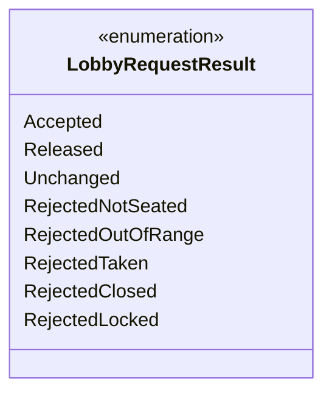

# LobbyRequestResult

> Outcome of a character request in the online room (see `LobbyRules.EvaluateRequest`).

**Módulo:** [[Modulo Networking|Networking]] · **Namespace:** `AlienFarms.Networking.Session` · **Archivo:** `Assets/Scripts/Networking/Session/LobbyRequestResult.cs`

## Hereda / implementa
`byte`

## Diagrama

## Valores
`Accepted`, `Released`, `Unchanged`, `RejectedNotSeated`, `RejectedOutOfRange`, `RejectedTaken`, `RejectedClosed`, `RejectedLocked`

## Usado por
[[LobbyRules]], [[NetworkLobbyState]]
