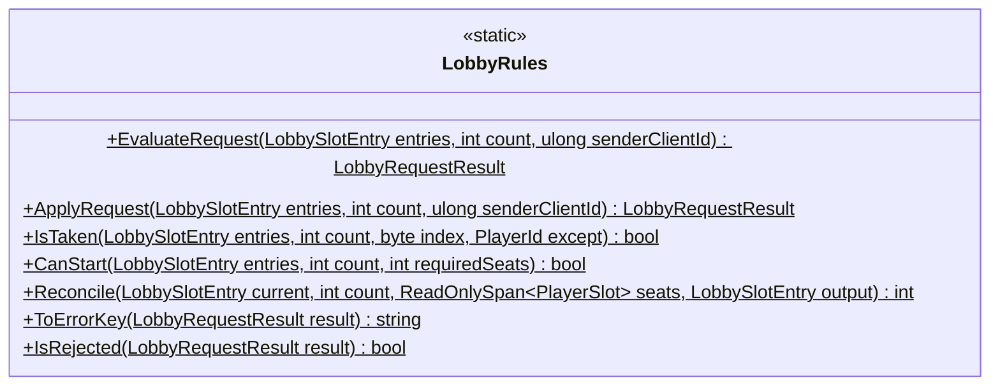

# LobbyRules

> Pure rules of the online room, applied by the server on a small mirror of the replicated seats (never on the NetworkList itself). Requests are processed one at a time, so when two players ask for the same character the first one wins and the second gets `LobbyRequestResult.RejectedTaken`.

**Módulo:** [[Modulo Networking|Networking]] · **Namespace:** `AlienFarms.Networking.Session` · **Archivo:** `Assets/Scripts/Networking/Session/LobbyRules.cs`

## Diagrama

## Usa
[[LobbyRequestResult]], [[LobbySlotEntry]], [[OnlineSessionErrorKeys]], [[PlayerId]], [[PlayerSlot]]

## Usado por
[[NetworkLobbyState]]
