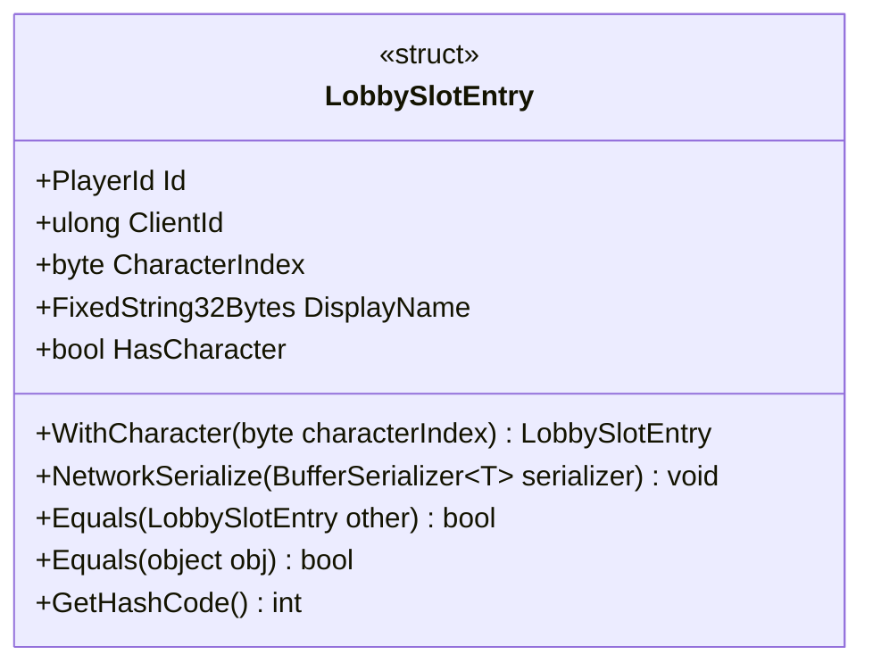

# LobbySlotEntry

> One seat of the online room as replicated by `NetworkLobbyState`. Element of a NetworkList, so it is unmanaged and equatable. `CharacterIndex` is `PlayerSlot.NoCharacter` while the seat has no pick; picking counts as ready.

**Módulo:** [[Modulo Networking|Networking]] · **Namespace:** `AlienFarms.Networking.Session` · **Archivo:** `Assets/Scripts/Networking/Session/LobbySlotEntry.cs`

## Hereda / implementa
`INetworkSerializable`, `IEquatable`

## Diagrama

## Usa
[[PlayerId]], [[PlayerSlot]]

## Usado por
[[LobbyRules]], [[NetworkLobbyState]]
