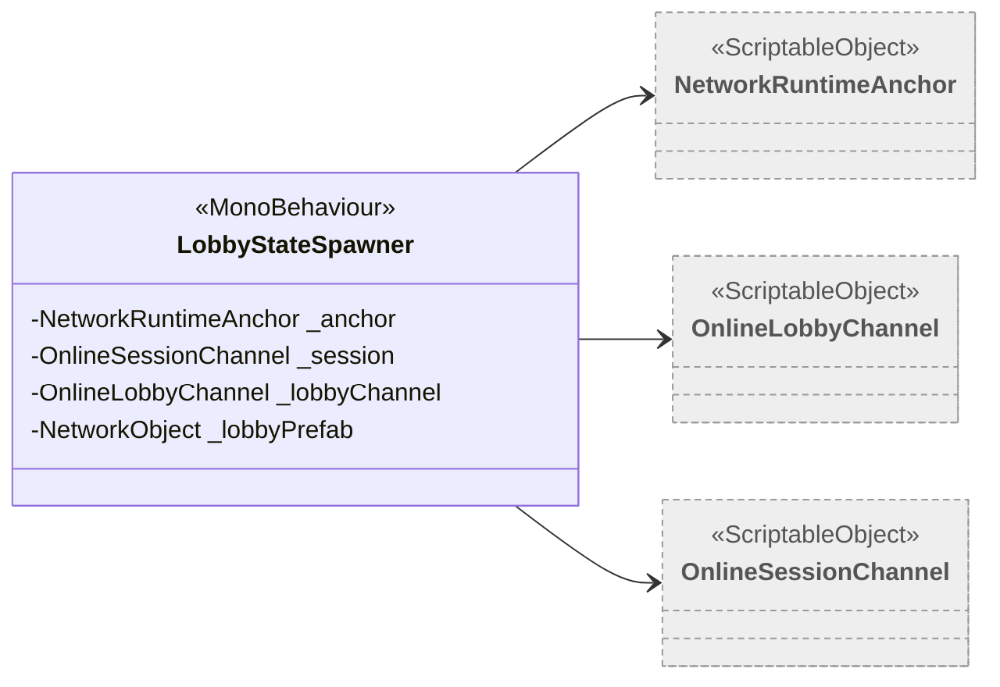

# LobbyStateSpawner

> MainMenu-only: spawns the networked room (`NetworkLobbyState`) once the host is in a Sessions + Relay session. Lives in the scene and not on the NetworkRoot, so a direct host from the dev panel never creates a room. Never despawns it: NGO's shutdown or the room itself (when the match starts) does.

**Módulo:** [[Modulo Networking|Networking]] · **Namespace:** `AlienFarms.Networking.Session` · **Archivo:** `Assets/Scripts/Networking/Session/LobbyStateSpawner.cs`

## Hereda / implementa
`MonoBehaviour`

## Diagrama

## Usa
[[NetworkRuntimeAnchor]], [[NetworkSceneLoader]], [[OnlineLobbyChannel]], [[OnlineLobbyPhase]], [[OnlineSessionChannel]], [[OnlineSessionStatus]], [[Status]]
