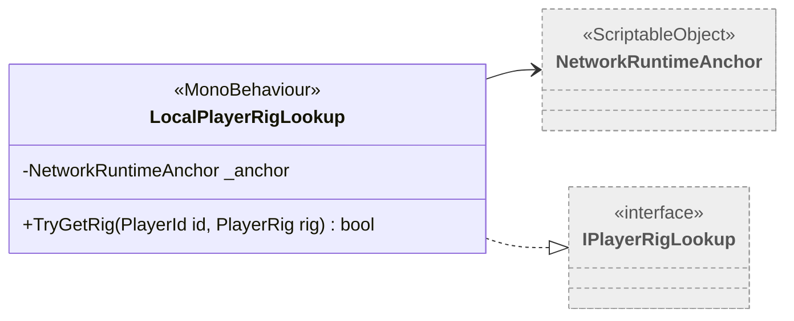

# LocalPlayerRigLookup

> Online `IPlayerRigLookup` for the shared menus (pause, results): only the avatar this machine owns is found, so a menu is routed to the local player and never touches remote avatars. Lives under OnlineModeRoot and is injected into the PlayerMenuRouter by the GameModeRouter.

**Módulo:** [[Modulo Networking|Networking]] · **Namespace:** `AlienFarms.Networking.Player` · **Archivo:** `Assets/Scripts/Networking/Player/LocalPlayerRigLookup.cs`

## Hereda / implementa
`MonoBehaviour`, [[IPlayerRigLookup]]

## Diagrama

## Usa
[[IPlayerRigLookup]], [[NetworkPlayer]], [[NetworkRuntimeAnchor]], [[PlayerId]], [[PlayerRig]]
