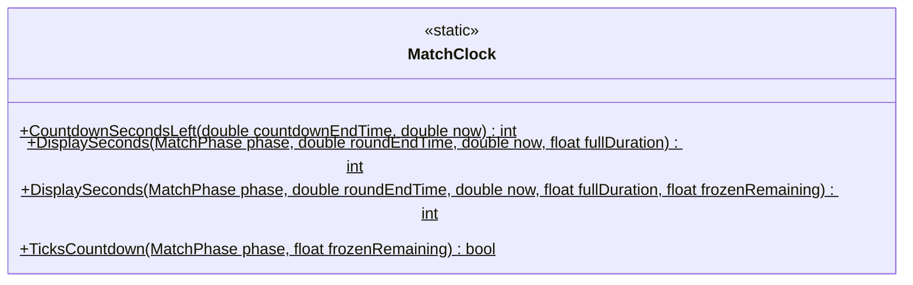

# MatchClock

> What a client shows from the replicated server times (0 messages per second for the timer): the whole seconds left of the countdown and of the round, rounded up like MatchTimer.DisplaySeconds.

**Módulo:** [[Modulo Networking|Networking]] · **Namespace:** `AlienFarms.Networking.Match` · **Archivo:** `Assets/Scripts/Networking/Match/MatchClock.cs`

## Diagrama

## Usa
[[MatchPhase]]

## Usado por
[[NetworkMatchState]]
