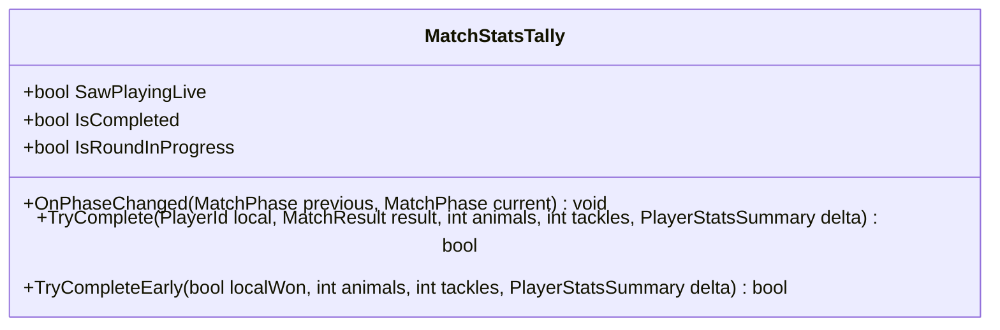

# MatchStatsTally

> Decides which round this instance records (plain C#): only one whose Playing phase it saw live, once. A reconnection that enters straight into Results (the replica re-raises the result) never counts again. Countdown and WaitingForPlayers start over.

**Módulo:** [[Modulo Networking|Networking]] · **Namespace:** `AlienFarms.Networking.Persistence` · **Archivo:** `Assets/Scripts/Networking/Persistence/MatchStatsTally.cs`

## Diagrama

## Usa
[[MatchPhase]], [[MatchResult]], [[PlayerId]], [[PlayerStatsRules]], [[PlayerStatsSummary]]

## Usado por
[[OnlineMatchStatsRecorder]]
