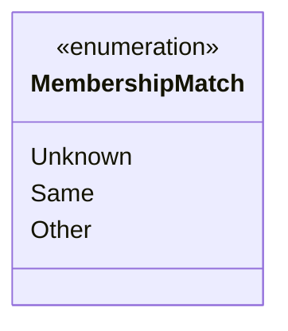

# MembershipMatch

> How a joined session (read through a probe) relates to the join code asked for (`MembershipRules.Classify`).

**Módulo:** [[Modulo Networking|Networking]] · **Namespace:** `AlienFarms.Networking.Session` · **Archivo:** `Assets/Scripts/Networking/Session/MembershipMatch.cs`

## Diagrama

## Valores
`Unknown`, `Same`, `Other`

## Usado por
[[MembershipRules]], [[RelaySessionConnection]]
