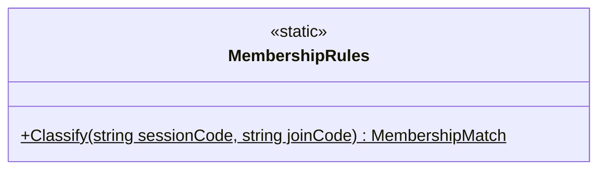

# MembershipRules

> Pure rules of reclaiming a lobby membership this player still holds (a join by code refused as 'already in a session'): only the session whose code is the one asked for is reconnected to, and only a session known to be another one is left (leaving one's own session would release the seat as Left).

**Módulo:** [[Modulo Networking|Networking]] · **Namespace:** `AlienFarms.Networking.Session` · **Archivo:** `Assets/Scripts/Networking/Session/MembershipRules.cs`

## Diagrama

## Usa
[[MembershipMatch]], [[SessionCodeFormat]]

## Usado por
[[RelaySessionConnection]]
