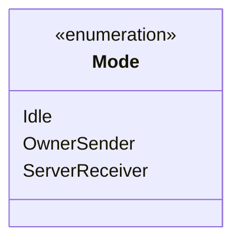

# Mode

**Módulo:** [[Modulo Networking|Networking]] · **Namespace:** `AlienFarms.Networking.Player` · **Archivo:** `Assets/Scripts/Networking/Player/NetworkPlayerInput.cs`

## Diagrama

## Valores
`Idle`, `OwnerSender`, `ServerReceiver`

## Usa
[[IPlayerCommandSource]], [[InputCommandBatch]], [[InputCommandBuffer]], [[NetworkCommandSource]], [[NetworkSettings]], [[PlayerAim]], [[PlayerGrabber]], [[PlayerInputCommand]], [[PlayerInputHandler]], [[PlayerMovement]], [[ThirdPersonCamera]]

## Usado por
[[GameModeRouter]], [[JoinPromptView]], [[LanguageSelector]], [[MatchSession]], [[NetworkCarry]], [[NetworkPlayerInput]], [[OnlinePanelView]], [[SaveStatusBadgeView]]
