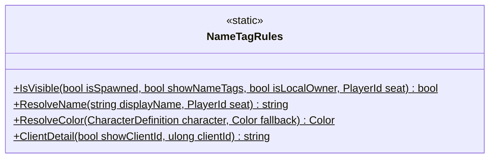

# NameTagRules

> Pure rules of `NetworkNameTag`: when an avatar's tag shows, which name and color it uses and the debug "client N" line (course topic 9: the reconnected player gets a new client id).

**Módulo:** [[Modulo Networking|Networking]] · **Namespace:** `AlienFarms.Networking.Player` · **Archivo:** `Assets/Scripts/Networking/Player/NameTagRules.cs`

## Diagrama

## Usa
[[CarriableOwnerRules]], [[CharacterDefinition]], [[PlayerId]]

## Usado por
[[NetworkNameTag]]
