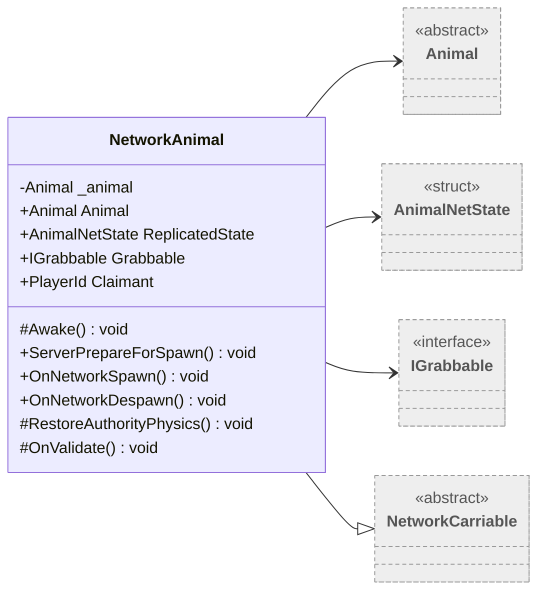

# NetworkAnimal

> Network adapter of a pooled `Animal`. Pose: NetworkTransform + NetworkRigidbody (server authority). Server: mirrors `Animal.StateChanged` (and the drop reason) into `AnimalNetState` and drives ownership / parenting while it is carried (`NetworkCarriable`). Clients: the animal is a Replica; the replicated state is applied with `Animal.ApplyReplicatedState` and the matching grab / drop / capture GameEvents are raised here (never on the server: no double events on the host). Inactive is never applied from the state: the despawn (pool handler) takes it out of play.

**Módulo:** [[Modulo Networking|Networking]] · **Namespace:** `AlienFarms.Networking.Animals` · **Archivo:** `Assets/Scripts/Networking/Animals/NetworkAnimal.cs`

## Hereda / implementa
[[NetworkCarriable]]

## Diagrama

## Usa
[[Animal]], [[AnimalNetState]], [[AnimalState]], [[DropReason]], [[GameEvents]], [[IGrabbable]], [[NetworkCarriable]], [[PlayerId]], [[SimulationRole]]

## Usado por
[[NetworkAnimalPoolHandler]], [[NetworkPoolLog]], [[NetworkSpawnRegistry]]

## Eventos que publica
[[Eventos GameEvents#OnAnimalCaptured|OnAnimalCaptured]], [[Eventos GameEvents#OnAnimalDropped|OnAnimalDropped]], [[Eventos GameEvents#OnAnimalGrabbed|OnAnimalGrabbed]], [[Eventos GameEvents#OnAnimalLeftZone|OnAnimalLeftZone]]

## Eventos que escucha
[[Eventos GameEvents#OnAnimalDropped|OnAnimalDropped]]
