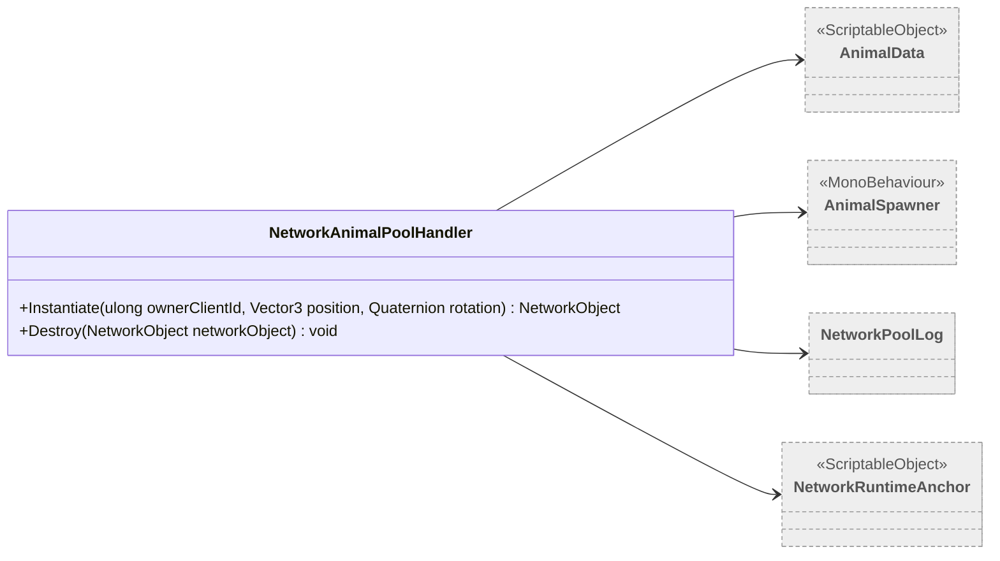

# NetworkAnimalPoolHandler

> NGO instance handler for one animal type, on top of the spawner's existing pool. Clients: a spawn takes a pooled Replica (`AnimalTypePool.GetForReplica`) instead of instantiating, and a despawn returns it (`Animal.Despawn` as Replica = back to the pool, no events). On the server instances come from the simulation itself (see `NetworkSpawnRegistry`); NGO only calls Destroy there while shutting down: `NetworkAnimal` has already switched an animal still in play to Replica in OnNetworkDespawn, so it goes back to its pool too, while an Authority instance is left alone.

**Módulo:** [[Modulo Networking|Networking]] · **Namespace:** `AlienFarms.Networking.Pooling` · **Archivo:** `Assets/Scripts/Networking/Pooling/NetworkAnimalPoolHandler.cs`

## Hereda / implementa
`INetworkPrefabInstanceHandler`

## Diagrama

## Usa
[[Animal]], [[AnimalData]], [[AnimalSpawner]], [[AnimalTypePool]], [[NetworkAnimal]], [[NetworkPoolLog]], [[NetworkRuntimeAnchor]], [[PooledParenting]], [[SimulationRole]]

## Usado por
[[NetworkSpawnRegistry]]
