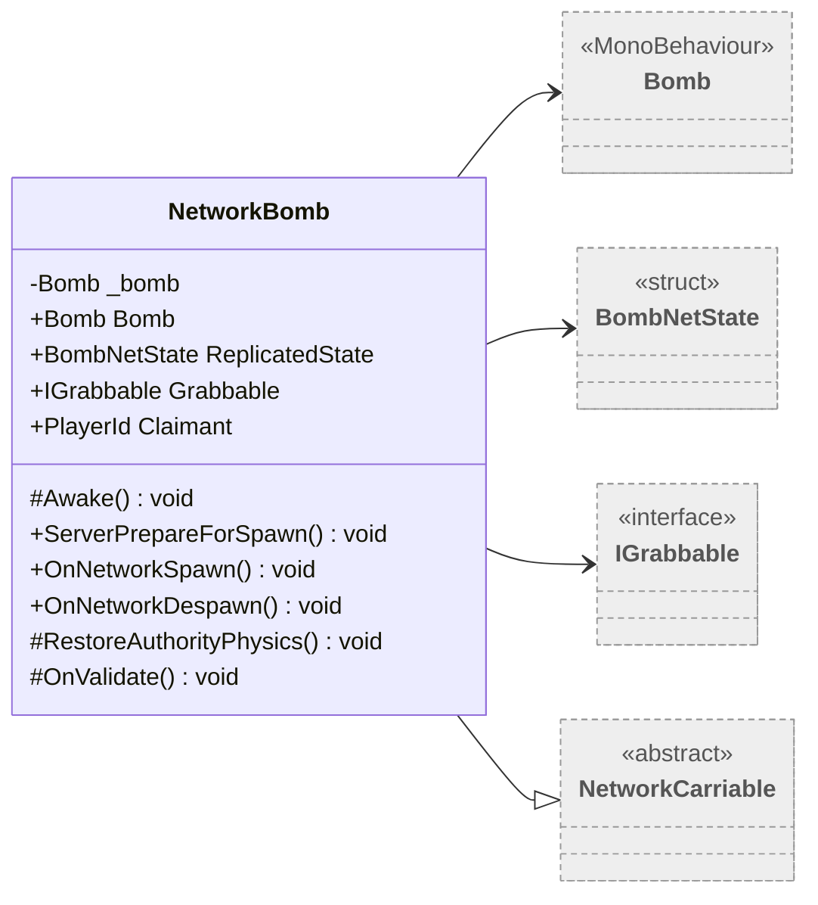

# NetworkBomb

> Network adapter of a pooled `Bomb`. Pose: NetworkTransform + NetworkRigidbody (server authority). Server: mirrors `Bomb.StateChanged` into `BombNetState`; the holder owns it from the grab until it detonates or leaves play (a thrown bomb keeps its thrower as owner; dropped inert, it goes back to the server). The detonation (event, not state) reaches clients through `DetonatedRpc`, and the stuns it causes through `PlayerStunnedRpc` (the stun itself is replicated in the player snapshot). Clients: the bomb is a Replica; the state is applied with `Bomb.ApplyReplicatedState` and the bomb GameEvents are raised here (never on the server).

**Módulo:** [[Modulo Networking|Networking]] · **Namespace:** `AlienFarms.Networking.Items` · **Archivo:** `Assets/Scripts/Networking/Items/NetworkBomb.cs`

## Hereda / implementa
[[NetworkCarriable]]

## Diagrama

## Usa
[[Bomb]], [[BombNetState]], [[BombState]], [[GameEvents]], [[IGrabbable]], [[NetworkCarriable]], [[PlayerId]], [[SimulationRole]]

## Usado por
[[NetworkBombPoolHandler]], [[NetworkSpawnRegistry]]

## Eventos que publica
[[Eventos GameEvents#OnBombArmed|OnBombArmed]], [[Eventos GameEvents#OnBombDespawned|OnBombDespawned]], [[Eventos GameEvents#OnBombDetonated|OnBombDetonated]], [[Eventos GameEvents#OnBombGrabbed|OnBombGrabbed]], [[Eventos GameEvents#OnBombSpawned|OnBombSpawned]], [[Eventos GameEvents#OnPlayerStunned|OnPlayerStunned]]

## Eventos que escucha
[[Eventos GameEvents#OnPlayerStunned|OnPlayerStunned]]
