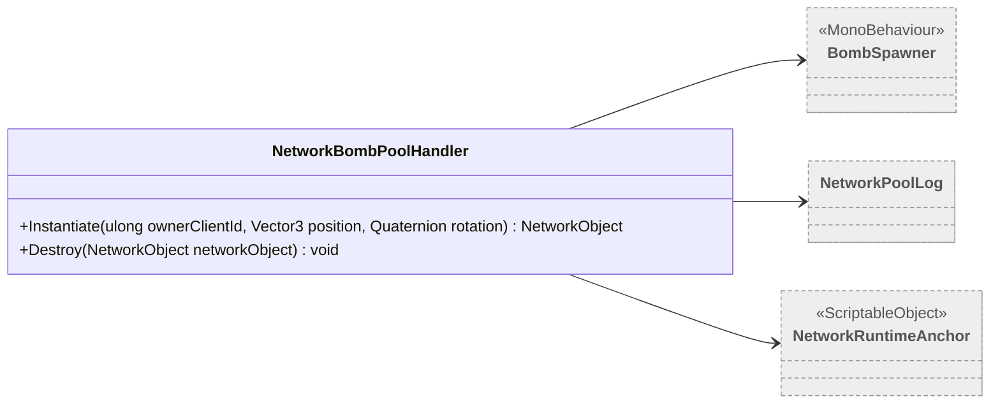

# NetworkBombPoolHandler

> NGO instance handler for the bomb prefab, on top of the `BombSpawner` pool. Clients: a spawn takes a pooled Replica (`BombSpawner.GetForReplica`), a despawn returns it (`Bomb.Despawn` as Replica). On the server NGO only calls Destroy while shutting down: `NetworkBomb` has already switched a bomb still in play to Replica in OnNetworkDespawn, so it goes back to the pool too; an Authority one is left alone.

**Módulo:** [[Modulo Networking|Networking]] · **Namespace:** `AlienFarms.Networking.Pooling` · **Archivo:** `Assets/Scripts/Networking/Pooling/NetworkBombPoolHandler.cs`

## Hereda / implementa
`INetworkPrefabInstanceHandler`

## Diagrama

## Usa
[[Bomb]], [[BombSpawner]], [[NetworkBomb]], [[NetworkPoolLog]], [[NetworkRuntimeAnchor]], [[PooledParenting]], [[SimulationRole]]

## Usado por
[[NetworkSpawnRegistry]]
